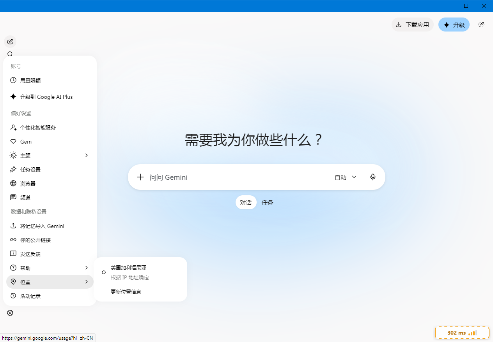
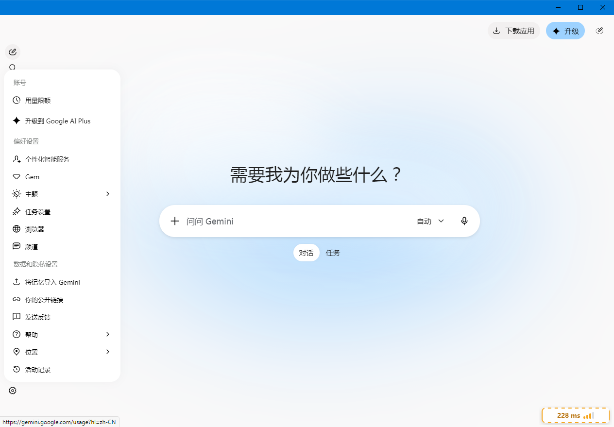

# GemCN · Gemini 网页的非官方桌面外壳

> 本项目是**第三方非官方工具**，与 Google LLC 无任何关系，未获其授权或背书。
> `Gemini`、`Google` 是 Google LLC 的商标，本项目仅在描述所访问的网页服务时使用。
> 项目不包含 Google 的任何图标、字体、代码或从官方安装包提取的资源，不伪装浏览器身份，不绕过验证码与访问限制。
> 使用前请阅读 [DISCLAIMER.md](DISCLAIMER.md)。

一个 Windows 桌面外壳：用系统自带的 **Microsoft Edge** 以“应用窗口”方式打开公开网页，
默认简体中文，数据全部放在程序目录里，绿色免安装。

## 界面预览

主界面就是 Gemini 网页本身，程序只额外在窗口右下角挂一条延迟小条（延迟数字 + 4 格信号，鼠标穿透，不遮挡按钮）。



左侧菜单的“位置”展开能看到当前出口地区；“更新位置信息”会重新按 IP 判定。窗口右下角的小条只在 Gemini 为前台窗口时可见，切到其他程序自动隐藏。



> 两张截图中的品牌标志与账号头像已做虚化处理，仅用于说明界面布局。

## 为什么要用 Edge 而不是自带内核

用 Electron 自建窗口加载 Google 登录页时，常见结果是：

**“无法登录 · 此浏览器或应用可能不安全”**

排查过程（可复现，仅供技术参考）：

| 客户端 | 提交账号后 |
| --- | --- |
| Electron 原生身份 | 拦 |
| Electron 伪装 Chrome（UA + `sec-ch-ua*` + JS 指纹全对齐） | 拦 |
| Electron 伪装 Edge（版本号与内置 Chromium 对齐） | 拦 |
| 真实浏览器（同 IP、同随机邮箱） | 放行 |

原因在于 Google 校验的是浏览器构建本身，不是请求头。所以“伪装浏览器”这条路不可行；
本项目选择**不使用任何伪装**：直接调用本机真实的 Edge，用 `--app` 模式开一个无地址栏窗口，
并配上程序目录内的独立配置文件。

这也能解释本项目为何**不内置浏览器、不伪装 UA、不碰验证码**：它只是一个启动器与托盘外壳。

## 功能

- 调用本机 Edge 以应用窗口方式打开 Gemini 网页，默认简体中文（`--lang=zh-CN` + `?hl=zh-CN`）
- 便携数据：`data\edge-profile` 保存 Cookie / 登录态 / 缓存，不写 C 盘、不污染日常浏览器
- 下载目录固定在 `data\工作文件夹\下载`
- 网络状态：启动检测 + 每 10 分钟检测；窗口右下角先弹出口地区提示（绿=可用 / 红=不支持，10 秒自动消失，`settings.regionTipSeconds` 可调），随后只保留延迟小条（延迟数字 + 4 格信号，绿<150 ms / 橙 150–400 ms / 红>400 ms，20 秒刷新，鼠标穿透）
- 小条跟随窗口（后台常驻采样，约 300ms 跟上）；只在 Gemini 为前台窗口时显示，不压在其他程序上层；延迟档位长时间不变自动降到半透明（`settings.statusIdleFadeMs`，默认 25 秒）
- 出口 IP 属地中文显示（ip-api 优先，国内接口兜底）
- 账号记忆：多账号保存，可在本机保存邮箱（可选保存密码，Windows DPAPI 加密），点一下打开登录页并填入表单；验证码、二次验证一律由本人完成
- 托盘常驻、单实例、关于对话框显示真实路径
- 运行日志 `data\debug.log`

## 运行（源码方式）

```bash
npm install
npm start          # 启动（入口 edge-main.js）
npm run pack       # 打包到 dist/
```

要求：Windows 10/11 x64，已安装 Microsoft Edge（系统自带）。

图标：仓库只提供自制矢量图 `assets/icon.svg`，不包含二进制图标。
打包前需自行将其转为 `assets/icon.ico`（任意 SVG→ICO 工具均可）；不生成也能跑，
去掉 `pack` 脚本里的 `--icon=assets/icon.ico` 即可使用 Electron 默认图标。

## 目录结构

```
edge-main.js            启动器主进程：找 Edge、起窗口、托盘、网络检测、账号记忆、右下角小条
auto-login.js           账号自动填写（本机 CDP 驱动本机 Edge 的登录表单，不碰验证码）
netcheck.js             网络与出口 IP 属地检测、延迟采样
geo-zh.js               境外地名中文化
regions.js              出口国家 → 可用/不支持地区判断（仅界面提示）
accounts.js             账号存储（DPAPI 加密）
account-manager.html    账号管理窗口
preload-manager.js      账号管理窗口的预加载脚本
status.html             右下角常驻延迟小条
toast.html              出口地区提示弹窗
assets/icon.svg         自制矢量图标（唯一图标资源）
doc-ui-main.png         界面截图（主界面）
doc-ui-region.png       界面截图（地区信息）
使用说明.md             面向使用者的使用说明
DISCLAIMER.md           免责声明（请务必阅读）
```

## 已知边界

- 需要本机装了 Edge；没装会提示去官网安装（不会自动下载）
- 不代填验证码、不绕过二次验证，不绕过任何地区限制
- 不提供代理/VPN/节点，网络与出口地区均为使用者自行配置
- 登录能否通过取决于 Google 对 IP / 设备的风险判断，与本项目无关
- 适配的 Edge 版本越新越好；旧版本（如 92）能跑，但建议升级

## 风险与免责

- 本项目不提供任何担保，使用风险自负；详细条款见 [DISCLAIMER.md](DISCLAIMER.md)
- 请自行遵守 Google 服务条款、Microsoft Edge 许可协议与所在地法律法规
- 不建议用于商业分发、批量账号操作或代登录服务

## 作者

个人自用工具，作者：付自晧

## 许可

代码采用 MIT License，见 [LICENSE](LICENSE)。商标与第三方资源归各自所有者，不在授权范围内。
