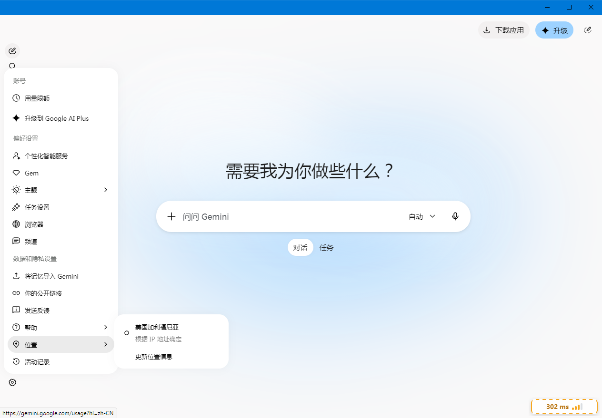
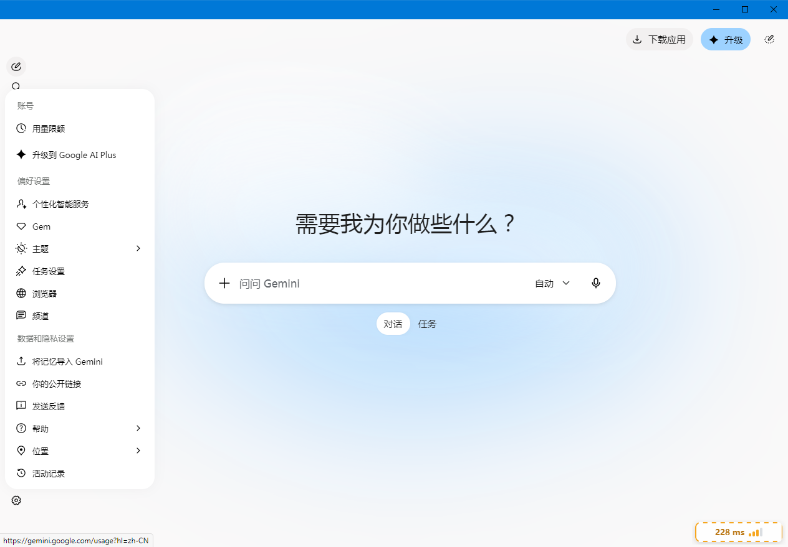

| 项目 | 内容 |
|---|---|
| 名称 | GemCN（非官方 Gemini 网页桌面外壳） |
| 版本 | 1.3.1 |
| 运行环境 | Windows 10 / 11，需已安装 Microsoft Edge |
| 形态 | 绿色版（解压即用，数据在程序目录） |

> 本项目与 Google 无任何关联，未获其授权或认可，仅以普通浏览器方式打开公开网页。不提供代理、不绕过地区限制或人机验证，请看 [DISCLAIMER.md](DISCLAIMER.md)。

## 一、界面预览

主界面就是 Gemini 网页本身，程序只在窗口右下角多挂一条延迟小条（数字 + 4 格信号，鼠标穿透）。



左侧菜单“位置”展开能看到当前出口地区。窗口右下角的小条只在 Gemini 为前台窗口时可见，切到其它程序自动隐藏。



> 截图中的品牌标志与账号头像已做虚化处理，仅用于说明界面布局。

## 二、它能解决什么

- 双击即进 Gemini，不必手打网址、不必找书签。
- 独立浏览器数据目录：跟日常 Edge 的书签、插件、登录互不干扰，关掉程序再打开登录仍在。
- 界面简体中文，首次启动自动跳 `hl=zh-CN`。
- 网络提示：先告诉你当前网络地区，再用右下角小条显示延迟。
- 便捷功能：账号管理、开机自启、下载目录统一到 `data\工作文件夹\下载`。

## 三、使用

### 第一次打开

1. 双击 `GemCN.exe`（源码用户：`npm i` 后 `npm start`）。
2. 程序调起你本机已装的 Edge，弹出应用窗口并加载 Gemini。
3. 登录 Google 账号，同正常浏览器，登录后长期有效。

### 网络与延迟提示

- **地区提示**：窗口弹出后先在右下角显示 10 秒当前出口地区。受支持地区为绿色，不受支持或未知为橙/红色提示。
- **延迟小条**：地区提示消失后，右下角只留一条 150×42 的小条（数字为平均延迟毫秒 + 信号图标）。
  - 绿色 = 畅通（<150 ms）
  - 橙色 = 中等（150–400 ms）
  - 红色 = 繁忙或超时（>400 ms）
- 小条行为：跟随 Gemini 窗口（约 300ms 内到位）；**只在 Gemini 为前台窗口时显示，不压在任何其他窗口上方**；延迟档位长时间不变时自动降到半透明（`settings.statusIdleFadeMs`，默认 25 秒），数值一变立刻恢复正常。鼠标点击可穿透。
- 不需要时在设置里关掉“显示延迟小条”（`showStatusWidget=false`）。

### 账号管理

1. 点标题栏“账号”按钮打开管理窗口。
2. 添加多个 Google 账号，命名清楚（如 工作 / 私人）。
3. 一键切换：关闭当前会话、用指定账号登录，不必反复输密码。

### 常见问题速查

| 现象 | 处理 |
|---|---|
| 提示需要人机验证 / 无法登录 | 用真实 Edge 登录（本程序就是真 Edge）；仍失败请自行在浏览器里完成验证；本程序不提供绕过 |
| 页面空白 / 一直转圈 | 确认网络能直连；点标题栏刷新 |
| 提示地区不受支持 | 这是 Gemini 自身地区限制，本程序不提供代理或绕行方案 |
| 延迟条不动 / 看不到 | 先看 Gemini 是否为当前前台窗口；它不是前台时小条按设计隐藏 |
| 想彻底重登 | 关闭程序，删除 `data\edge-profile`，重启重新登录 |
| 数据想带走 | 整个程序目录拷走即可，`data` 是同目录 |

## 四、目录结构

```
GemCN.exe            主程序
resources\app\       源码运行目录
  edge-main.js        主进程（启动 Edge、窗口、延迟条、设置）
  netcheck.js         延迟测速与地区识别
  status.html         右下角延迟小条
toast.html            地区提示弹窗
data\                 运行时数据（可删，删后需重新登录）
  edge-profile\       独立浏览器数据
  settings.json       配置
  accounts.json       账号列表
  net-status.json     最近一次网络状态
  debug.log           运行日志（排查时看这个）
  工作文件夹\下载\     下载目录
```

## 五、配置

`data\settings.json` 常用项：

| 项 | 说明 | 默认 |
|---|---|---|
| `showStatusWidget` | 是否显示右下角延迟小条 | `true` |
| `regionTipSeconds` | 地区提示显示秒数 | `10` |
| `statusIdleFadeMs` | 延迟不变多久后降到半透明 | `25000` |
| `checkIntervalMin` | 网络检测间隔（分钟） | `20` |
| `windowSize` | 窗口尺寸 | `1280×880` |
| `autoStart` | 开机自启 | `false` |

改完重启生效。

## 六、自行打包（源码用户）

```
npm install
npm run pack
```

产物在 `dist\GemCN-win32-x64\`。图标不再随仓库附带（官方图标属 Google 资源，不应随本项目分发），需要自有图标时自行准备 `assets\icon.ico` 并在打包命令中加 `--icon=assets/icon.ico`。

## 七、已知限制

- 依赖本机 Microsoft Edge；Edge 92 以下版本可能加载异常，建议升级到最新。
- 不提供代理、不伪装指纹、不绕过地区限制与人机验证。
- 网页由 Google 提供，界面变动、功能限制以其官方为准。
- 仅在 Windows 10 / 11 x64 上实测。

## 八、许可

代码以 MIT 发布（见 [LICENSE](LICENSE)）。Gemini、Google 等名称为其各自权利人商标，本项目仅为描述用途引用。
